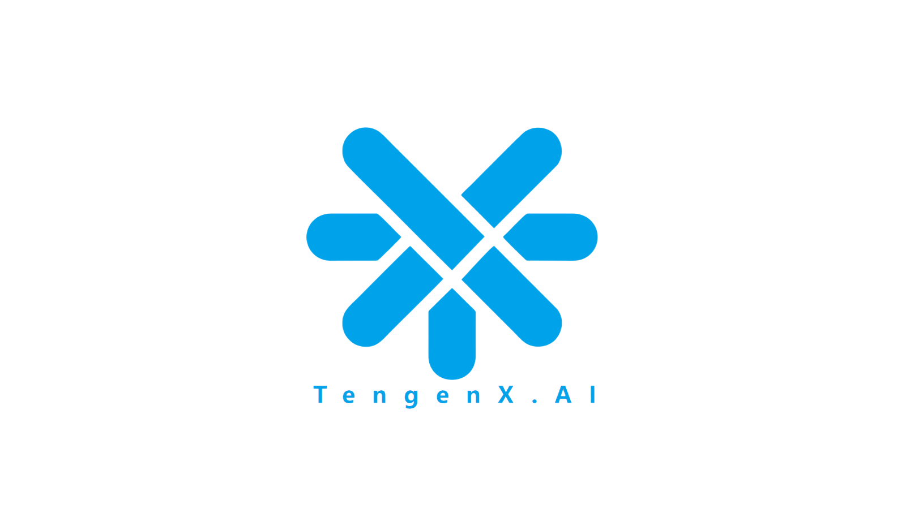
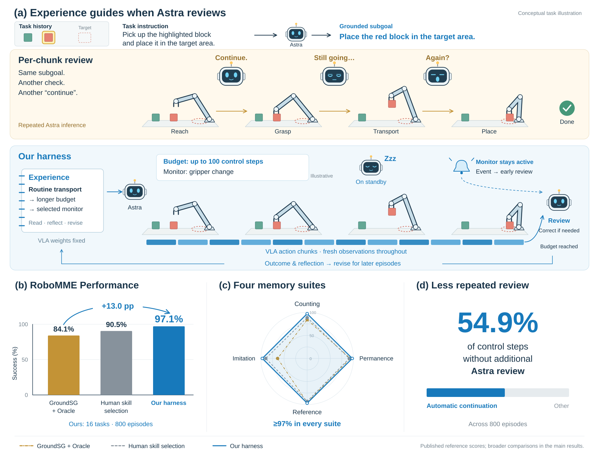

<div align="center">

# Can Astra Guide a VLA to Solve RoboMME?

### A Self-Evolving Harness for Memory-Dependent Manipulation

Xingping Chen<sup>1</sup> · Zihao Mo<sup>1</sup> · Yimin Chen<sup>2</sup> · Yu Lu<sup>2</sup> · Zhanghui Kuang<sup>2</sup> · Guanbin Li<sup>1,*</sup>

<sup>1</sup> Sun Yat-sen University &nbsp; <sup>2</sup> TengenX &nbsp; <sup>*</sup> Corresponding author

<p align="center">
  
  &nbsp;&nbsp;&nbsp;
  
</p>

<!-- Paper: add the arXiv link when available. -->
[](https://legend717.github.io/astra-guide-vla-website/)
[](LICENSE)

**English** | [简体中文](README_zh-CN.md)

</div>

<p align="center">
  
</p>

Astra plans and reviews; a frozen official GroundSG VLA executes; an experience
store informs later planning, delegation and recovery. The reported evaluation
uses `step-budget` mode. `astra-only`, `jev` and `rules-only` are also available
for comparison and recovery.

The technical report records **777/800 successes (97.1%)** on RoboMME.
See [results](docs/results.md) for the evaluation protocol and
[reproduction](docs/reproduction.md) to run the evaluation.

## Start here

1. Follow [installation](docs/installation.md) on Linux.
2. Obtain the official GroundSG checkpoint and set up your API credentials locally.
3. Follow [reproduction](docs/reproduction.md) for a single episode or a fresh full run.
4. Optionally, run the offline tests in the [installation guide](docs/installation.md#offline-tests).

The default branch contains the controller code and usage documentation. The report,
project website and four demonstration videos live in the independent
[website repository](https://github.com/Legend717/astra-guide-vla-website). Download the official VLA checkpoint
and simulator assets separately as described in the installation guide.

Clone the code repository:

```sh
git clone https://github.com/Legend717/astra-guide-vla.git
cd astra-guide-vla
```

## Experience presets

Both presets are included in this repository:

| Preset | Contents | Default updates |
| --- | --- | --- |
| [`initial`](assets/initial-experience/) | Shared global guidance and training-demonstration duration priors for all 16 tasks | After either outcome in episodes 0–4; after failure in episodes 5–49 |
| [`final`](assets/final-experience/) | Final experience snapshot from the completed evaluation | Frozen |

Select a preset with `--experience-preset initial` or `--experience-preset final`.
The evaluation driver copies it into a new run directory. The final preset includes
experience collected during the reported test evaluation; the initial preset starts
with training-derived duration priors. Report results for each preset separately.

## Preliminary JEV experiments

JEV was explored in preliminary experiments, but its performance did not meet our
expectations. The related code and experimental results have not been fully
organized for release. We retain the optional integration for reference;
the default `step-budget` mode runs without JEV.
If you are interested in these experiments or need setup details, please
[open an issue](https://github.com/Legend717/astra-guide-vla/issues).

## Layout

- `scripts/robomme_agent`: reasoning driver, tools, prompts and scheduling.
- `scripts/codex_supervisor`, `codex_rgb_eval.py`, `codex_symbolic_eval.py`: runtime bridges.
- `src`, `packages/openpi-client`: adapted OpenPi/MME-VLA inference dependencies.
- `assets/initial-experience`, `assets/final-experience`: initial global guidance with training priors, and the final experience snapshot.
- `configs`: reported model settings.
- `third_party/robomme_benchmark`: pinned official simulator submodule.
- `docs/`: installation, reproduction and results documentation.

## Attribution

See [NOTICE](NOTICE.md), [LICENSE](LICENSE) and [Gemma license](LICENSE_GEMMA.txt).
Upstream package names are retained for compatibility.
